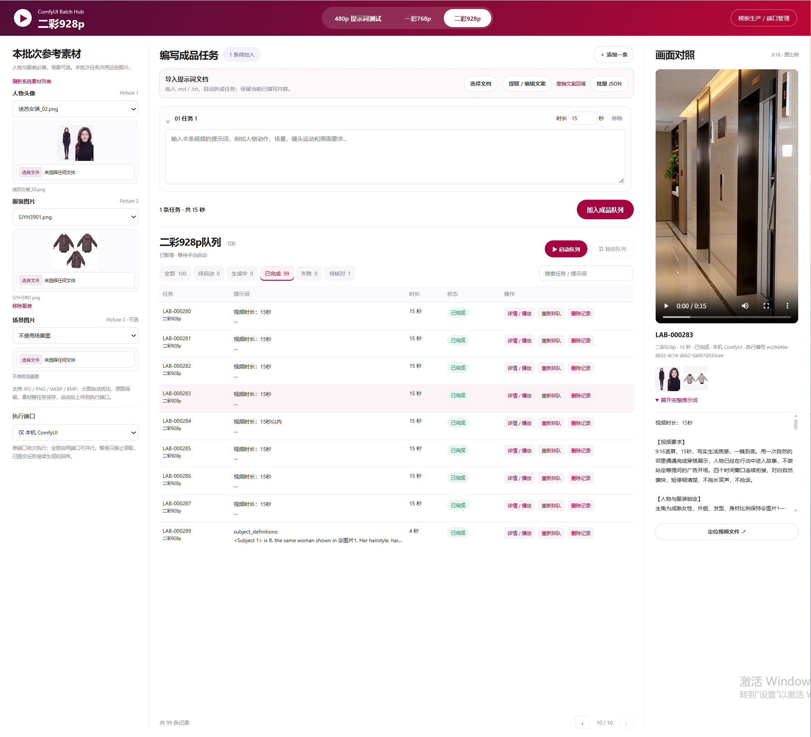

# ComfyUI Batch Worker

A local web application for managing ComfyUI video-generation queues across local and remote ComfyUI endpoints.

## Windows quick start

1. Install Python 3.10 or later and ensure `py` is available in PowerShell.
2. From this folder, run `py -m venv .venv`.
3. Install dependencies with `.venv\Scripts\python.exe -m pip install -r requirements.txt`.
4. Copy `config.example.json` to `config.json`, then set the ComfyUI endpoint(s) for this computer.
5. Double-click `双击启动批量生产中枢.bat` and open `http://127.0.0.1:8999`.

The app keeps rendering paused until Start is clicked in the page. ComfyUI must be running and reachable at the configured endpoint. The default starter configuration uses `http://127.0.0.1:8188`.

## Runtime data

Task history, uploaded assets, output videos, local endpoint settings, logs, and backups are machine-local runtime data. Keep them out of source control. The repository contains application code, UI assets, tests, and workflow templates only.

## Project layout

- `server/`: HTTP API, queue services, endpoint monitoring, and dispatch workers.
- `web/`: browser UI and static assets.
- `templates/`: standard workflow templates.
- `prompt_lab/workflow*.json`: prompt-lab test and finished-video workflow definitions.
- `tests/`: regression and integration test sources.
## Main page screenshot

